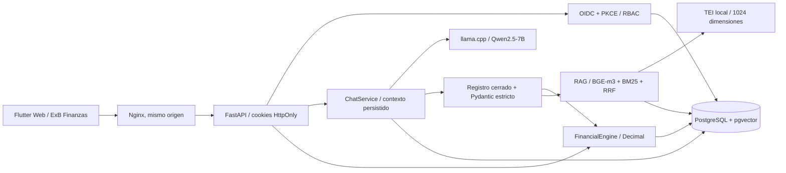

# Arquitectura del MVP

El navegador solo recibe datos autorizados. Las cifras viajan como strings;
Flutter opera en centavos enteros. Las conversiones a double se limitan a la
geometría de los gráficos. `Money` usa NUMERIC(20,2) en PostgreSQL y centavos
enteros en el banco de pruebas SQLite, sin sincronización ni base local cliente.

## Decisiones

- Se conserva el proyecto Flutter en la raíz; `frontend/` es el empaquetado
  Nginx. Los materiales recibidos de frontend y backend quedan intactos.
- Los siete informes mantienen las dimensiones del backend recibido.
  Presupuesto, modificaciones y movimientos se agregan por separado para
  evitar multiplicación de importes por joins de uno a muchos.
- El importador respeta las reglas reconciliadas del prototipo: `Ejecución`
  directamente, todos los valores de `presupuesto Bs`, PTTO independiente y
  solo años reales. Una ingesta repetida del mismo SHA-256 es idempotente;
  otra fuente para una gestión existente se rechaza y no elimina datos.
- El modelo interpreta intención, nunca genera SQL. La ejecución usa un
  registro cerrado de nueve herramientas, validación estricta y alcances SQL.
  Las respuestas numéricas finales se construyen con el resultado del motor;
  no se aceptan números narrados por el LLM como fuente de verdad.
- El prompt incluye diccionario y catálogo autorizados por turno. El contexto
  se almacena separado del historial. Las sesiones verifican propietario.
- El chat emite SSE reales mediante Fetch streaming en Flutter Web. Nginx
  desactiva buffering. Los resultados financieros son paquetes independientes
  de la respuesta textual, y no se pierde la tarjeta al llegar el texto final.
- OIDC se realiza en backend para no almacenar tokens en el navegador.
  El estado de PKCE/nonce dura cinco minutos; la firma se verifica con JWKS,
  emisor y audiencia. Una identidad válida requiere una cuenta prehabilitada.
  No se heredan permisos de un rol elegido en el formulario ni del modelo.
- Demo es una opción de desarrollo explícita. Producción exige OIDC, cookies
  Secure y configuración válida. Las sesiones son opacas y revocables.
- Las APIs financieras son de lectura. La vista previa Excel no confirma
  escrituras. Los documentos y el diccionario sí tienen administración auditada.

## Fuentes técnicas consultadas

- [SQLAlchemy Numeric y Decimal](https://docs.sqlalchemy.org/en/20/core/type_basics.html#sqlalchemy.types.Numeric).
- [StreamingResponse en FastAPI](https://fastapi.tiangolo.com/advanced/custom-response/).
- [Tool calling en llama.cpp](https://github.com/ggml-org/llama.cpp/blob/master/docs/function-calling.md), que requiere `--jinja`.
- [Modelos y hardware TEI](https://huggingface.co/docs/text-embeddings-inference/en/supported_models).

La disponibilidad de memoria, el tiempo de carga de modelos y la latencia del
primer token dependen del equipo. No se garantiza carga de 7B en cinco minutos
ni respuesta en dos segundos sin medir el hardware y modelos desplegados.
