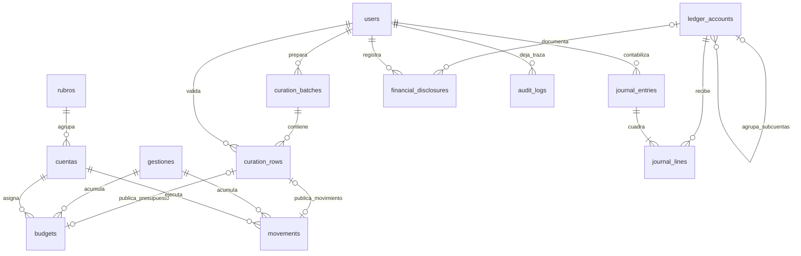

# Modelo relacional

`curation_rows.target_kind/target_id` es un vínculo polimórfico de procedencia a presupuesto o movimiento, no una FK SQL: el historial debe sobrevivir eliminaciones/restauraciones financieras. La API serializa las consolidaciones y conserva los cambios en auditoría. Su estado se invalida ante ediciones posteriores.

`original`, `data`, `issues` y `prediction` son JSON de preparación de entradas incompletas; al consolidar se convierten en hechos con dimensiones y FKs normalizadas. El libro de partida doble es independiente del plan presupuestario; no existe una conversión inferida entre ambos.

`ledger_accounts.kind/section` clasifica los estados y su jerarquía. `journal_lines` conserva importes `NUMERIC(20,2)` y actividad de efectivo. `journal_entries` registra tipo, evento patrimonial, comprobante, fecha, autor y motivo. El cuadre entre líneas se exige en la única API de contabilización; un acceso SQL administrativo directo debe respetar esta invariancia.
